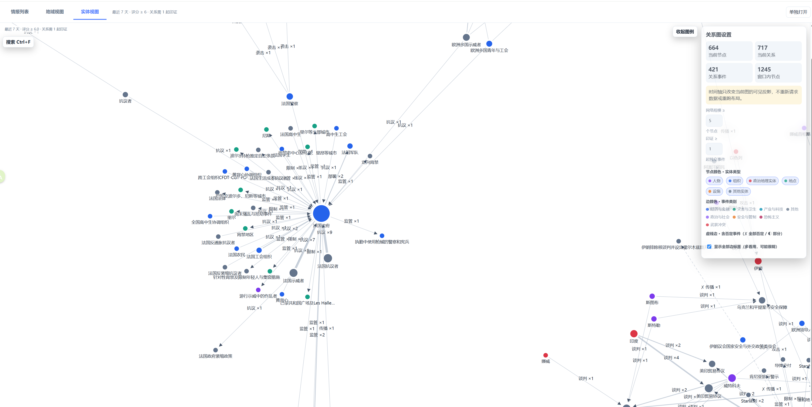
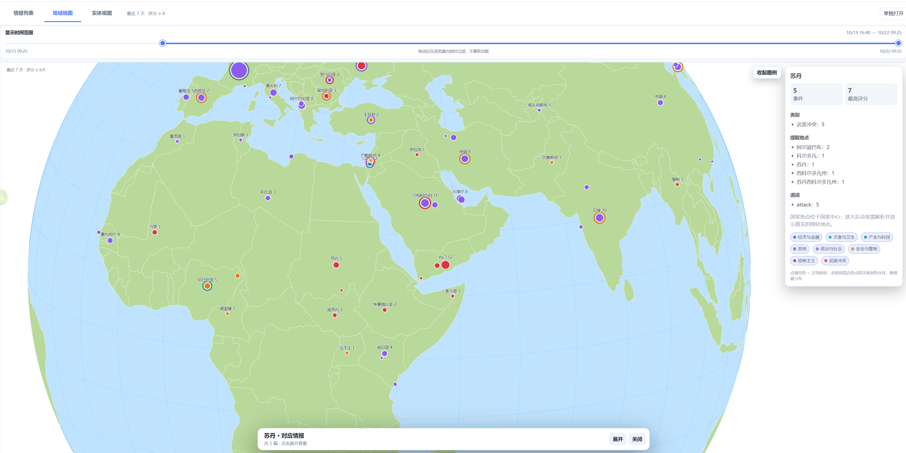

## IntelligenceIntegrationSystem

情报整合系统：抓取主流新闻网站的公开新闻，使用AI进行分析、评分以及对事件事件进行结构化抽取的情报系统。

发布地址：[https://sleepysoft.org](https://sleepysoft.org)


项目地址：[https://github.com/SleepySoft/IntelligenceIntegrationSystem](https://github.com/SleepySoft/IntelligenceIntegrationSystem/tree/SubSystem)


## V4 版本说明

当前生产端已切换到v4版本，数据和v2基本不兼容（其实框架大致相同，但v4额外的结构化信息是v2所不具备的）。

v2版本在 (main分支)[https://github.com/SleepySoft/IntelligenceIntegrationSystem/tree/main] ，不再维护。

v2版本的最终数据会在我续费度盘后上传（蹲打折）。


## V4 版本更新与通知

- [主要] 增加结构化事件内容提取以及地或和实体视图
  
- 将非核心功能提取为可插拔的子系统

- 设计上支持多个并行子情报系统（暂名），如新闻、产业、金融（未彻底实现）
  
- 为缓存优化prompt结构，降低部署成本
  
- 修复CPU占用量过大的Issue

- 更全面和透明的运行状态监控

## V4 版本特点与预览

基于结构化的事件内容提取，情报能轻易地按地域及关系图谱等方式组织及浏览。在正式部署中几乎抛弃“模糊”且极占用资源的向量数据库。

#### 地域视图



#### 实体视图



## 起因

现在的新闻素质堪忧，特别是国内媒体。

+ 一方面现代社会每日产生的新闻数量巨大，并且参杂着毫无情报价值的水文。

+ 另一方面媒体看重点击量，所以标题成为了吸引点击的工具而非事件的概括。

我一直认为，公开信息中有四成只需要看标题，有两成看总结即可，而只有不到一成的信息有阅读全文的必要。而剩下的三成都是垃圾。

既然媒体们自己不体面，那么我来让新闻体面。


## 已接入的媒体

所属大区按媒体总部或主要编辑来源划分，而不是按其报道覆盖范围划分。中国大陆直连状态沿用已有记录；新接入且尚未持续验证的媒体标记为“未核验”。

| 所属大区 | 国家/地区 | 媒体 | 域名 | 标识 | 中国大陆直连 |
|---|---|---|---|:---:|:---:|
| 全球 | 国际 | 英为财情（Investing.com） | `investing.com` | 🌍 | 是 |
| 东亚 | 中国 | 中国新闻网 | `chinanews.com.cn` | 🇨🇳 | 是 |
| 东亚 | 中国 | 新华网 | `news.cn` | 🇨🇳 | 是 |
| 东亚 | 日本 | 日本广播协会（NHK） | `nhk.or.jp` | 🇯🇵 | 是 |
| 东亚 | 韩国 | 韩联社（Yonhap） | `yna.co.kr` | 🇰🇷 | 未核验 |
| 东南亚 | 新加坡 | 亚洲新闻台（CNA） | `channelnewsasia.com` | 🇸🇬 | 未核验 |
| 东南亚 | 印度尼西亚 | 雅加达邮报（The Jakarta Post） | `thejakartapost.com` | 🇮🇩 | 未核验 |
| 南亚 | 印度 | 印度时报（The Times of India） | `timesofindia.indiatimes.com` | 🇮🇳 | 未核验 |
| 西亚/中东 | 土耳其 | 阿纳多卢通讯社 | `aa.com.tr` | 🇹🇷 | 是 |
| 西亚/中东 | 土耳其 | NTV | `ntv.com.tr` | 🇹🇷 | 是 |
| 西亚/中东 | 卡塔尔 | 半岛电视台 | `aljazeera.com` | 🇶🇦 | 是 |
| 西亚/中东 | 以色列 | i24NEWS | `i24news.tv` | 🇮🇱 | 未核验 |
| 西亚/中东 | 以色列 | 耶路撒冷邮报（The Jerusalem Post） | `jpost.com` | 🇮🇱 | 未核验 |
| 欧洲 | 英国 | 英国广播公司（BBC） | `bbc.com` | 🇬🇧 | 否 |
| 欧洲 | 英国 | 卫报（The Guardian） | `theguardian.com` | 🇬🇧 | 未核验 |
| 欧洲 | 德国 | 德国之声 | `dw.com` | 🇩🇪 | 否 |
| 欧洲 | 西班牙 | 国家报（El País） | `elpais.com` | 🇪🇸 | 否 |
| 欧洲 | 法国 | 法兰西24（France 24） | `france24.com` | 🇫🇷 | 未核验 |
| 欧洲 | 法国 | 法国国际广播电台（RFI） | `rfi.fr` | 🇫🇷 | 否 |
| 欧洲 | 俄罗斯 | 莫斯科时报（The Moscow Times） | `themoscowtimes.com` | 🇷🇺 | 未核验 |
| 欧洲 | 俄罗斯 | 塔斯社 | `tass.com` | 🇷🇺 | 是 |
| 欧洲 | 泛欧洲 | 欧洲新闻台（Euronews） | `euronews.com` | 🇪🇺 | 未核验 |
| 非洲 | 泛非洲 | 非洲新闻台（Africanews） | `africanews.com` | 🌍 | 未核验 |
| 北美洲 | 加拿大 | 加拿大广播公司（CBC） | `cbc.ca` | 🇨🇦 | 否 |
| 北美洲 | 美国 | 美国之音（VOA） | `voanews.com` | 🇺🇸 | 否 |
| 南美洲 | 巴西 | 巴西通讯社（Agência Brasil） | `agenciabrasil.ebc.com.br` | 🇧🇷 | 未核验 |
| 南美洲 | 乌拉圭 | MercoPress | `en.mercopress.com` | 🇺🇾 | 未核验 |
| 大洋洲 | 澳大利亚 | 澳大利亚广播公司（ABC） | `abc.net.au` | 🇦🇺 | 否 |

## 环境配置及部署运行

### 资源要求（不含 VectorDB）

以下口径包含 IIS Web、Crawler、MongoDB、Nginx 和单一 headless 代理，不包含桌面 GUI、VectorDB 与翻译子服务：

| 资源     |   最低配置 |         推荐配置 |
| -------- | ---------: | ---------------: |
| CPU      |     2 vCPU |           4 vCPU |
| 内存     |      4 GiB |            8 GiB |
| Swap     |      2 GiB |          4–8 GiB |
| 可用磁盘 | 30 GiB SSD | 100 GiB NVMe/SSD |
| GPU      |     不需要 |           不需要 |

当前实测核心栈平均约占 1.0 GiB、保守峰值约 1.25 GiB；MongoDB 当前约 474 MiB，
但会随工作集、索引和页缓存增长。“MongoDB 需要 4 GiB”应理解为整机容量建议，不是固定常驻 4 GiB。

完整测量范围、磁盘留存和代理 GUI 差异见：[IIS 部署资源要求](doc/deployment_resource_requirements.md)。

#### 依赖软件

+ MongoDB

程序使用MongoDB数据库存储情报文档，这是一个NoSql数据库，请在官网下载：
> 
> https://www.mongodb.com/products/self-managed/community-edition
> 

同时建议安装mongodb tools，用以导出及导出数据库（从某个版本开始命令行工具不再和MongoDB主程序打包）：
> 
> https://www.mongodb.com/try/download/database-tools
> 

#### 向量模型（向量数据库用）

[bge-m3](https://huggingface.co/BAAI/bge-m3)


#### 创建与激活虚拟环境（可选）

本项目要求 Python 3.11 以上。当然，不创建虚拟环境，直接使用系统默认的 Python 环境也可以。

> 所谓python虚拟环境，其实非常简单，它就是一个目录，当你切换到这个虚拟环境时，使用的解析器、安装的库、使用的库，都仅限于该目录下，从而和其它环境隔离。
> 
> 知道这个原理后，大家应该能想到：使用pycharm时，选择已创建的虚拟环境其实就是选择这个目录下的python.exe。

创建虚拟环境主要有三种方法：
+ 原生的venv
+ Anaconda（及其兼容方法）
+ uv

##### venv

```
# 创建虚拟环境
# - 通常在项目目录下执行以下命令，虚拟环境的python版本跟你当前运行的python环境有关
# - 对我来说，通常是在anaconda下创建一个指定版本python的虚拟环境，再使用这个虚拟环境创建venv
# - （那为什么不直接用anaconda？好问题。）

python -m venv .venv

# 切换到该虚拟环境（接下来安装依赖前都需要先切换到该虚拟环境，下同）

# ---- Windows ----
.venv\Scripts\activate.bat

# ----- Linux -----
source .venv/bin/activate
```

##### Anaconda

Anaconda好处是方便，缺点是重

下载：https://www.anaconda.com/download

```
# 创建虚拟环境
conda create -n iis python=3.11

# 切换到该虚拟环境
conda activate iis
```

##### uv

这是现在流行的工具，非常轻量，而且快，不过我还不是很熟悉。以下内容来自AI。

```
# 安装uv
pip install uv

# 创建虚拟环境
uv venv

# 切换到该虚拟环境
.venv\Scripts\activate.bat

# 接下来可以使用pip install -r，也可以使用uv的方式安装依赖（自行查阅）。
```

#### 程序部署与安装依赖

```
# Clone this project to your local
git clone https://github.com/SleepySoft/IntelligenceIntegrationSystem.git

# Enter this project dir
cd IntelligenceIntegrationSystem

# Important: Fetch sub modules
git submodule update --init --recursive

# --------------------------------------------------------------------------------- #
# ! Reference to above: Create virtual environment and switch to this environment ! #
#           Use `conda activate iis` or `.venv\Scripts\activate.bat`                #
# --------------------------------------------------------------------------------- #

# Old pip version will not support utf-8, so upgrade to newest pip first.
python.exe -m pip install --upgrade pip

# Install dependency
pip install -r requirements.txt
pip install -r IntelligenceCrawler/requirements.txt
pip install -r PyLoggingBackend/requirements.txt
pip install -r AIClientCenter/requirements.txt
pip install -r MyPythonUtility/requirements.txt
pip install -r VectorDB/requirements.txt

# Optional: If has dependency issue when using upper command, use this command instead: 
pip install -r requirements_freeze.txt

# After pip install. Install playwright's headless browser
playwright install chromium

# ------------------------------------------------------------------------------------
# ! Before launching program, you should do some config first (read following section)
# ------------------------------------------------------------------------------------

# Run the Vector DB (Optional)
python VectorDB/VectorDBBService.py \
  --db-path ./_data/VectorDB \
  --model /path/to/bge-m3 \
  --agg-store-dir ./_data/Aggressive

# Run main service
python IntelligenceHubLauncher.py

# Run collectors
python CrawlerServiceEngine.py
```

#### 程序配置

+ 重要：将 [iis_example.yaml](_config/iis_example.yaml) 复制为 `_config/iis.yaml`，只填写部署差异。
>
> [IISConfig.py](IISConfig.py) 负责默认值、严格 schema 校验以及运行时组件装配。主配置
> 只分为 `server`、`database`、`hub`、`access`、`optional_subsystems` 和可选的 `web`，不会要求
> 用户复制大量默认参数。未知字段会在启动时直接报错，避免“写了但实际没有生效”。
> `optional_subsystems` 下的键是子系统名，每个子系统自带 `enabled` 及必要参数；
> 当前包括翻译、向量、态势视图、公开情报视图、实体别名和 Batch 分析；例如翻译子系统用
> `client_group` 选择 `ai_clients.yaml` 中的 Client 分组。公开搜索的分页、时间窗和限流位于
> `web.public_search`，公开态势视图的时间范围与时间线实体数限制位于
> `optional_subsystems.intelligence_views`。
>
> AI Client 使用独立的 `ai_clients.yaml`；采集器使用独立的 `collector.json`，外网代理
> 也配置在采集器文件中。`access.collector_tokens` 必须与采集器的 `default_token` 对应。
>
> 不想手改 YAML 时，可运行 `Scripts/iis_configure.sh` 打开仅监听本机的 IIS 配置页；
> 主服务已运行时也可登录后访问 `/admin/config/`。AI Client 的配置页由
> AIClientCenter 自己提供，位于 `/monitor/ai-client-dashboard/config/`。两套页面都支持
> 引导编辑、真实 schema 校验、密钥遮蔽、原子保存和历史恢复；AI Client 还可直接热重载，
> IIS 主配置则在保存后重启服务生效。设计边界与独立运行方式见
> [IIS 配置中心说明](IISConfiguration/README.md)。
> 

+ 重要：运行 [UserManagerConsole.py](Scripts/UserManagerConsole.py) ，按提示增加一个用户并设置密码，否则后台无法登录。

+ AI服务配置
> 
> 如果想使用 AI 进行情报分析，需要配置 [ai_clients.yaml](_config/ai_clients.yaml)。
> 标准 Client 使用工厂式 YAML：公共字段为 `factory`、`name`、`group`、`enable`；
> `enable` 默认为 `true`，设为 `false` 时保留但不加载该条目，其余字段直接传给工厂，
> 分组并发统一写在顶层 `group_limits`。自定义 Client 使用外部工厂函数，不直接拼装结果列表。
> 
> 配置请参考：[ai_clients_example.yaml](_config/ai_clients_example.yaml) ，复制为
> `ai_clients.yaml` 后按需要修改对应项即可。AIClientCenter 的独立 CLI/harness
> 配置请参阅 [AIClientCenter/README.md](AIClientCenter/README.md)。
> 免费 API 服务的当前额度、使用边界，以及针对 Event V4 的 Client 能力/性能基准方案见
> [免费 LLM API 资源池与 Client 基准验证方案](doc/free_llm_api_and_client_benchmark.md)。
> Gemini/Groq/NVIDIA 的限额配置可直接复制
> [_config/ai_clients_gemini_80_example.yaml](_config/ai_clients_gemini_80_example.yaml)，
> 并通过对应环境变量提供 Key。`gemini_free`、`groq_free`、`nvidia_free` 等工厂直接复用
> AIClientCenter 的 Provider preset；模型、额度和恢复策略仍由 Provider 维护，组并发由 YAML 明确配置。
> 调用观测默认写入 `_data/ai_client_observations.db`，只保存模型、耗时、次数、逻辑
> 字节量及估算/服务商实报 Token 等元数据，不保存请求和回复正文；可在
> `ai_client_center.call_observation` 中关闭或调整保留期。登录后台后可从 AI Client
> Manager 进入 Usage 页面，查看总览、趋势、切片排行和最近调用，也可手动重新读取配置并
> 原子替换整个 Client 池；重载失败时继续保留旧池，不会让 IIS 因暂时取不到 Client 而退出。
> Client 条目还可用 `availability.available` 或 `availability.unavailable` 配置每日调度时间窗；
> `timezone` 可选，省略时使用系统本地时区并在启动或重载时输出 warning 确认。
> 准备组合多个免费服务时，也可复制
> [_config/ai_clients_recommended_example.yaml](_config/ai_clients_recommended_example.yaml)
> 为 `_config/ai_clients.yaml`，然后按文件顶部说明填写环境变量。
> 不启动主程序即可预览 Event V4 Client 基准计划：
> `python Scripts/benchmark_ai_clients.py`；确认 Client 和调用次数后增加 `--execute`
> 才会发送真实请求，结果写入 `_data/ai_benchmarks/`。
> 

#### 启动

核心采集与分析需要启动 Web 和 Crawler 两个进程；使用语义搜索、向量聚合等能力时，再启动
独立的 VectorDB 服务：

+ [IntelligenceHubLauncher.py](IntelligenceHubLauncher.py)
> 
> 核心服务，启动该服务后即可通过网页访问其主要功能。
> 

+ [CrawlerServiceEngine.py](CrawlerServiceEngine.py)
> 
> 爬虫服务，启动该服务才能抓取情报/新闻。
> 

+ [可选] [VectorDB/VectorDBBService.py](VectorDB/VectorDBBService.py)
> 
> 向量数据库服务，开启该服务后可以使用高级的搜索及关联功能。
> 
> 参考启动命令：
>   ```bash
>   python VectorDB/VectorDBBService.py \
>     --db-path ./_data/VectorDB \
>     --model /path/to/bge-m3 \
>     --agg-store-dir ./_data/Aggressive
>   ```
> 
> 如果没有下载离线向量数据库，可以通过 [rebuild_vector_index.py](Scripts/rebuild_vector_index.py) 脚本增量新建向量索引。参考启动命令：
>   ```commandline
>       python Scripts/rebuild_vector_index.py rebuild
>   ```
> 

Linux 生产部署可直接使用 [systemd](systemd/README.md) 中的独立单元：`iis-web.service`
运行 `IntelligenceHubLauncher.py`，`iis-crawler.service` 运行 `CrawlerServiceEngine.py`，
`iis.target` 默认统一拉起前两者；VectorDB 单元按配置单独启用。旧的单一 `iis.service` 和
根目录进程组启动脚本已移除。

Linux 单命令安装正在按审计路线分阶段实现。当前可先运行无副作用的部署诊断：

```bash
deploy/iisctl doctor
```

诊断工具、当前落地阻塞项和各阶段验收标准见
[Linux 部署目录](deploy/README.md)与[审计及路线图](deploy/AUDIT_AND_ROADMAP.md)。

#### 使用

+ 打开 [localhost:5000/login](localhost:5000/login) 输入刚才配置的账号密码进入后台页面。

+ 打开 [localhost:8001](localhost:8001) 进入向量数据库的管理页面。

+ 打开 [localhost:5000](localhost:5000) 则是无密码的公开页面。

+ 登录后台后可打开 [localhost:5000/debug/intelligence](http://localhost:5000/debug/intelligence)
  人工粘贴正文并调试 AI 分析。该入口自动补齐 `CollectedData` 元数据，将 `source` 固定为
  `__IIS_MANUAL_TEST__`，结果仅保存在当前进程的有界内存列表中，不写入 cache、archive、
  low_value 或 conversation 存储，也不触发翻译或向量归档扩展。页面可分别选择情报域与
  Event V4 分析机制，再选择对应的 Prompt 版本；Prompt 可编辑并仅对本次任务覆盖，
  日期、正文等占位符仍由正式分析消息构造器拼接。


## 其它工具

+ MongoDB工具
  > https://www.mongodb.com/try/download/database-tools
  > 
  > 用以导出/导出MongoDB记录，可以配合[mongodb_exporter.py](Scripts/mongodb_exporter.py)一系列脚本使用。


## 程序架构

### 原理

本程序核流程为：抓取 -> 提交到情报中心 -> 清洗、AI分析 -> 筛选并重发布 -> 归档

### 模块

#### 抓取

> 本程序通过RSS抓取公开新闻，原因在于这类新闻抓取难度小（本身就是给RSS阅读器的公开信息），且法律风险低。对于没有RSS的网站，也支持列表页抓取。

程序中由[CrawlerServiceEngine.py](CrawlerServiceEngine.py)驱动[CrawlTasks](CrawlTasks)目录下的抓取模块。
> 
> 框架保留了任务重载管线，但当前文件监控 observer 未启用；新增或修改抓取任务后需要重启
> Crawler 服务才能生效。任务可通过 `_config/collector.json` 的 `disabled_tasks` 禁用。
> 

抓取模块事实上基于两个框架：

+ 之前的简易框架：[RssFeedsBasedCrawlFlow.py](Workflow/RssFeedsBasedCrawlFlow.py)
> 
> 抓取模块通过partial构建偏函数供抓取流程调用。
>

+ 新的爬虫框架：[IntelligenceCrawler](IntelligenceCrawler)
> 
> 通过[CrawlerPlayground.py](IntelligenceCrawler/CrawlerPlayground.py)可视化生成抓取代码，
> 通过[IntelligenceCrawlFlow.py](Workflow/IntelligenceCrawlFlow.py)适配IIS抓取与提交流程。
> 

无论是哪个框架，最终都通过 [CommonFlowUtility.py](Workflow/CommonFlowUtility.py) 将抓取到的内容提交到IntelligenceHub。
> 
> 实际上采集数据只需要按照 `CollectedData` 定义的格式将数据通过 POST 提交到 IHub 的
> `/collect` 端点即可，无论采用什么方式抓取。应答中的 `resp` 为 `queued`（已接收）、
> `rejected`（明确拒绝，重试无意义）或 `error`（传输或内部错误，可重试）。
> 唯一需要注意的是如果设置了安全 Token，则提交数据时要将凭据附上。至于数据来源，IHub
> 并不关心，抓取服务和 IHub 也不一定要运行在同一台电脑上。
> 
> 使用通用流程的好处在于增加一个抓取任务非常方便，并且通用流程中实现了抓取记录和防重复抓取的功能。
> 
> 如果需要抓取的网页需要特殊技术，则需要自己实现抓取器。同时注意法律风险。
>

### IntelligenceHub

+ [IntelligenceHub.py](IntelligenceHub.py)（IHub）：兼容导出入口。核心运行时位于 `ServiceComponent/runtime/`，应用门面位于 `ServiceComponent/HubApplication.py`；两者不直接依赖 MongoDB、AI、向量或 Flask。
+ [IntelligenceHubWebService.py](IntelligenceHubWebService.py)：为IHub提供网络服务的模块，包括API、网页发布和鉴权。
+ 
+ [IntelligenceHubStartup.py](IntelligenceHubStartup.py)：组合根。它初始化情报域和 AI 管理器，并按配置安装主流程、cache 恢复、翻译、向量索引、定时维护、聚合和图谱等可选子系统。
+ [IntelligenceHubLauncher.py](IntelligenceHubLauncher.py)：IHub 的 WSGI 启动器，选用合适的 backend 载入 IntelligenceHubWebService 的 `wsgi_app`，
  > [20250910] 提供Flask原生、waitress、gunicorn三种WSGI服务器，默认服务器为waitress。
  > 
  > 注意gunicorn仅支持Linux。
  > 
  > 该文件不包含业务代码，几乎全部由AI生成，没有阅读的必要。如果对启动原理不理解，可以去搜索WSGI的机制。
  > 

> IHub 的生产主链只处理 Event V4，以
> `intake.received → analysis.requested → archive.completed` 为核心事件链。向量、翻译等可选
> 能力订阅归档事件，初始化失败也不会阻断主链；cache 恢复、LIVE/REPLAY 分流和到期重试
> 由独立端口完成。详情见 [hub_runtime_refactor.md](doc/hub_runtime_refactor.md)。历史图示仍可
> 用于理解业务概念，但其中的内部队列已由事件运行时替换。

### 分析

+ [prompts_event_v4.py](prompts_event_v4.py) 是 Event V4 Prompt 目录入口；
  [prompt_protocols.py](ServiceComponent/prompt_protocols.py) 将每个 Prompt 版本绑定到对应的
  前处理、后处理和校验链。事件谓词、角色与语义规则由 `event_engine` Registry 统一生成，
  IIS 不复制规则表。当前只注册并使用 v48；首次分配写入 cache，重试和重启恢复继续使用
  v48。缓存中残留的已移除版本会安全改派为 v48。

+ [IntelligenceAnalyzerProxy.py](ServiceComponent/IntelligenceAnalyzerProxy.py) 负责组织消息、
  调用 AI Client 并解析结果；[analysis_errors.py](ServiceComponent/analysis_errors.py) 统一区分
  network、rate_limit、provider_fatal、content_safety、json_syntax、schema_shape 和
  semantic_rule。结构/语义错误在同一 Client 上带反馈纠错一次，网络/限流切换 Client，
  内容安全先尝试带 `low_sensitivity` 标签的 Client，再进入终态。

+ 每次调用与每件终态的 IIS 侧效果数据写入 `_data/analysis_stats.db`，用于比较模型 × Prompt
  版本的一次成功率、错误分布、敏感率、延迟和 Token；影子分析结果写入
  `_data/analysis_shadow/`，只供灰度对比，不进入归档或索引。Provider Batch 是可关闭的
  独立子系统，状态写入 `_data/analysis_batch.db`。

### 内容发布

如前所述，网络服务由[IntelligenceHubWebService.py](IntelligenceHubWebService.py)提供。包含以下内容：

+ 登录与鉴权
    > 由 WebServiceAccessManager 和 [UserManager.py](ServiceComponent/UserManager.py) 进行管理。其中：
    >  
    > + API Token 位于 `_config/iis.yaml` 的 `access` 段
    > + 登录与注销的页面分别为：'/login'，'/logout'
    > + 用户信息保存在Authentication.db，通过[UserManagerConsole.py](Scripts/UserManagerConsole.py)管理用户。

+ WebAPI
    > '/api'接口：采用 [ArbitraryRPC.py](MyPythonUtility/ArbitraryRPC.py) ，不用额外编码或配置即可调用Stub的所有函数，同时支持任意层次的转发调用。
    > 
    > `/collect` 接口：接收 `CollectedData`，完成校验、来源去重和入队确认。
    > 
    > 其它API接口：子功能，如Log、统计、监控等等，由对应模块注册路由。
    >

+ 网页
    > 不使用前后端的架构，所有内容由服务器生成。包括以下文件：
    > 
    > [PostManager.py](ServiceComponent/PostManager.py)：根据 [posts](posts) 目录下的markdown文件生成HTML。
    > > [posts/index.md](posts/index.md)：登录后的管理主页
    > > 
    > > [posts/index_public.md](posts/index_public.md)：未登录用户的公开主页
    > 
    > [intelligence_detail.html](templates/intelligence_detail.html)：文章详情页。
    > 
    > [intelligence_list.html](templates/intelligence_list.html)：文章列表页。
    > 
    > [intelligence_cluster_list.html](templates/intelligence_cluster_list.html)：文章聚合页。
    > 
    > [intelligence_search.html](templates/intelligence_search.html)：文章查询页。
    > 
    > [intelligence_graph.html](templates/intelligence_graph.html)：情报态势追踪页。
    > 
    > `/views` 提供地域、实体、印证和实体时间线等统一情报视图；`/situation` 提供态势视图
    > 子系统页面；`/entity-alias/manage` 提供登录用户使用的全局实体与固定别名管理页面。
    > 这些子系统由各自 Blueprint 挂载，关闭或装配失败不会影响核心只读页面。
    > 

### 存储与目录结构

#### 目录结构

为了方便docker等部署需要，本项目将程序和数据分离。数据按其属性置于以下目录中：

+ [_config](_config)
> 配置文件，由用户手动编辑。

+ [_data](_data)
> 程序产生或暂存的数据，不要手动编辑。是最重要的目录，也是重点需要备份的目录。包含以下内容：
> + 向量数据库和聚类记录
> + 爬虫治理与抓取记录
> + AI Client 状态、调用观测与限流数据库
> + 分析效果统计、影子灰度记录和可选 Batch 状态

+ [_export](_export)
> 程序导出的数据，比如数据库文件。

+ [_log](_log)
> 程序的log文件，历史log会自动归档和管理。

+ [_products](_products)
> 程序的产物目录，预留。

#### 数据库存储

+ 情报存储（主要）
  > MongoDB，默认数据库名：IntelligenceIntegrationSystem。默认 `news` 子系统使用
  > `intelligence_` 前缀，主要集合为：
  > + intelligence_cached：Collector提交的采集到的原始新闻数据。
  > + intelligence_v4_archived：Event V4 经过处理并归档的数据。
  > + intelligence_v4_low_value：Event V4 低价值结果。
  > + intelligence_v4_events：由归档事件派生的查询索引。
  > + intelligence_v4_outbox：归档后扩展使用的持久事件出口。
  > + intelligence_intake_rejected：入口校验或去重拒绝的审计记录，不进入 cache。
  >
  > 其它情报子系统使用各自的集合前缀，不与 `news` 混写。`APPENDIX` 保存原文、运行状态、
  > 评分和扩展元数据，基本查询及前端列表默认裁剪该字段。

+ 实体名称与解析
  > 全局实体和固定别名的事实源位于 [EntityAlias/data](EntityAlias/data) 的 JSONL 文件，随
  > git 管理。与具体情报绑定的消歧采用非破坏性 MongoDB 旁表，不改写权威
  > `EVENT_EXTRACTION`；默认集合为 `intelligence_entity_global_resolutions`、
  > `intelligence_contextual_entities`、`intelligence_contextual_entity_resolutions` 和
  > `intelligence_entity_resolution_audit`。

+ 用户与运行状态
  > 登录用户保存在 `_config/Authentication.db`。AI 调用观测、IIS 分析效果、影子灰度和
  > Batch 状态分别位于 `_data/ai_client_observations.db`、`_data/analysis_stats.db`、
  > `_data/analysis_shadow/` 和 `_data/analysis_batch.db`（后两者仅在对应功能使用时产生）。


## 意见和建议

如果有意见和建议，可以到这个讨论下留言：[https://zhuanlan.zhihu.com/p/1957783829684154704](https://zhuanlan.zhihu.com/p/1957783829684154704)

或者可以加入wx或QQ讨论组（验证消息：IIS）：


